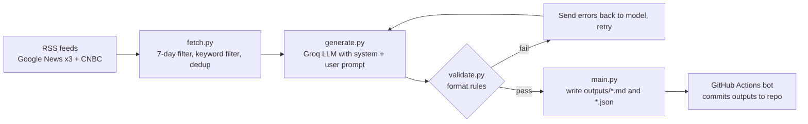

# Weekly IG Post Generator (Property News)

Generates Instagram posts (hook, caption, CTA, hashtags) in Bahasa Indonesia from the latest Indonesian property news. Built for the 99 Group AI Aptitude Challenge, Section 2, Option A.

Stack: Python, Groq API, GitHub Actions. No-code tools were not used so that the whole logic (code, prompts, workflow YAML, outputs) is readable in this repository.

## How it works



1. **Fetch** (`src/fetch.py`): reads 4 RSS feeds, keeps articles from the last 7 days, filters the general news feed by property keywords, removes duplicate titles.
2. **Generate** (`src/generate.py`): sends the article list to Groq with the prompts in `prompts/`, asks for 3 posts as JSON.
3. **Validate** (`src/validate.py`): checks post count, unique topics and sources, hook length, caption length (60-100 words target), hashtag count and format, emoji count, and forbidden phrases (for example "link bio", "anda", "judul"). If a check fails, the error list is sent back to the model and it retries (max 3 attempts).
4. **Output** (`src/main.py`): writes a timestamped Markdown and JSON file to `outputs/`.
5. **Automation** (`.github/workflows/weekly.yml`): runs every Monday 02:00 UTC (09:00 WIB) and can also be triggered manually (`workflow_dispatch`). The bot commits new output files to the repo.

## Model choice

`openai/gpt-oss-120b` on Groq. I listed the models available to my API key and picked the largest text model, because Bahasa Indonesia output was more natural in larger models. It is a reasoning model, so I set `reasoning_effort="low"` and raised `max_completion_tokens` (see "What went wrong"). The model name is read from the `GROQ_MODEL` environment variable.

## Prompt design

Prompts are in `prompts/system.txt` and `prompts/user.txt`. Earlier versions are kept in `prompts/history/` (v1, v2) to show the iteration.

Key decisions:
- Persona: social media strategist in the style of Rumah123 / 99.co.
- The model only sees the article **title**, source and date, not the article body. The prompt says to use only facts in the title and not to guess causes or invent details.
- Article text is treated as untrusted reference material, to reduce prompt injection risk from RSS content.
- CTAs must be engagement-based (save, share, comment, read the source), not "visit our website", because the account is sharing news, not owning it.
- Each post has a `fact_basis` field so the source of the main claim is visible in the output.

## Outputs

See `outputs/`. Files are named `posts-YYYY-MM-DD_HHMM.md` (and `.json`). Early files without the time suffix are from the first runs with prompt v2.

## Run locally

```bash
git clone https://github.com/abid1923/weekly-ig-property-generator.git
cd weekly-ig-property-generator
python -m venv .venv
.venv\Scripts\activate        # Windows
pip install -r requirements.txt
cp .env.example .env          # then fill GROQ_API_KEY and GROQ_MODEL
python src/main.py
```

To run in GitHub Actions, add the repository secret `GROQ_API_KEY` and use Actions -> Weekly IG Post Generator -> Run workflow.

## What went wrong and what I changed

- **Kompas RSS returned 404.** I tested every feed before building on it, dropped it, and added another Google News query instead.
- **Hardcoded model name gave 404.** The model I first used did not exist in my Groq account. I added a script to list available models and moved the model name into an environment variable.
- **`.env` was read too late.** The model name was read at import time, before `load_dotenv()` ran, so the old default was used. I moved the read inside the function.
- **JSON output was cut off.** `gpt-oss-120b` spends tokens on reasoning, so the JSON hit the token limit. I lowered reasoning effort, raised the token limit, and added retry on API errors.
- **Hallucinated details (prompt v1).** The model wrote claims like "strategic location, complete facilities" that were not in the headline. Prompt v2 added strict fact rules.
- **Meta-language leaked into captions (prompt v2).** Captions said "the headline states...". Prompt v3 forbids this, and the validator now rejects these words.
- **Validation and retry work in practice.** In one local run, attempt 1 failed (two captions were 45 and 46 words, target 60-100) and attempt 2 passed after the errors were sent back to the model.

## Known limitations

- **Only headlines are used, not article bodies.** Because of this, the model sometimes still adds details that are not in the headline. In the latest outputs I found examples (for example, a project description and reasons for popularity that the headline does not state). Prompt rules, `fact_basis` and format validation reduce this but do not remove it. `fact_basis` is written by the same model, so it is not an independent check.
- Topic diversity is requested in the prompt but only partly enforced by validation (topic labels are compared, not their meaning).
- Google News links are redirect links.
- No human approval step yet.

## What I would do next

1. Fetch the article body (with a text extractor) so claims can be grounded in real content.
2. Add a second LLM call as a fact-checker that compares each caption against the source text and triggers a retry on unsupported claims.
3. Add Telegram delivery with a `dry_run` mode for human approval before posting.
4. Add unit tests for `validate.py`.